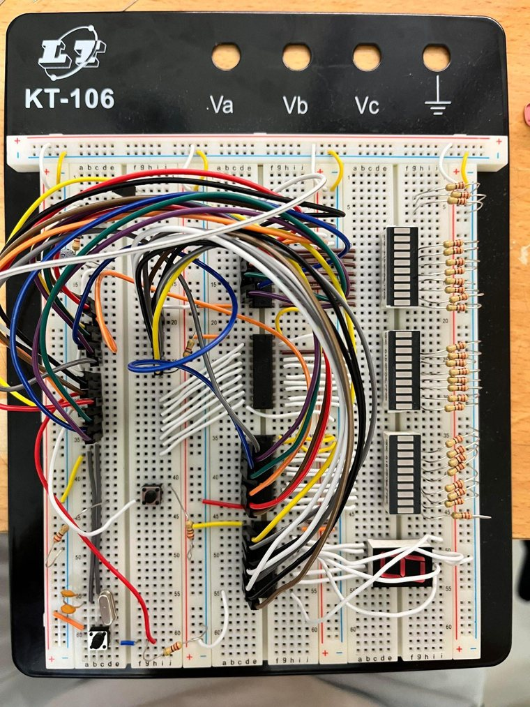

# 8051 Microprocessor Lab

Course projects using the 8051 microcontroller and assembly language. The work is arranged in three stages, from a simple LED circuit to a music box.

## Projects

| Stage | Project | Files |
| --- | --- | --- |
| Stage 01 | LED Display | [Notes](stage-01/README.md) · [Report](stage-01/led-display.pdf) |
| Stage 02 | Seven-Segment Display | [Notes](stage-02/README.md) · [Report](stage-02/seven-segment.pdf) |
| Final | Music Box | [Notes](final/README.md) · [Code](final/music-box.a51) · [Report](final/music-box.pdf) |

## Final Project — Music Box

The final project is an 8051 music box with three songs. Two switches are used to change tracks, and a seven-segment display shows the selected song number. The program uses external interrupts and timers for the song selection and speaker output.

**[Watch the music box demo on YouTube](https://youtu.be/ABH8-9qAU-I)**

[](https://youtu.be/ABH8-9qAU-I)

*Click the photo to watch the demo.*

For the assembly code, circuit notes, and report, see the [final project page](final/README.md).

## Files

```text
8051-microprocessor-laboratory/
├── README.md
├── .gitignore
├── stage-01/
│   ├── README.md
│   └── led-display.pdf
├── stage-02/
│   ├── README.md
│   └── seven-segment.pdf
├── final/
│   ├── README.md
│   ├── music-box.a51
│   ├── music-box.pdf
│   └── music-box.jpg
└── references/
    ├── song-tables.docx
    └── song-tables.md
```

The PDF reports are original coursework, and the final-project `.a51` source code is included without changes. The extra [song tables](references/song-tables.md) are separate reference notes, not part of the final program.
